# Tatua

[](https://github.com/kurosakiaduma/tatua-service-requests/actions/workflows/ci.yml)

Tatua ("resolve" in Swahili) is a mini eCitizen-style public service request
system. Citizens can report a broken streetlight, water issue, road problem,
garbage collection problem, sewage issue, or another local concern and follow
its status through resolution.

## Live demo

- **Live URL:** [Tatua Service Requests](https://tatua-service-requests.vercel.app/)

### Demo logins

The seed script creates these accounts with email confirmation already verified:

- Admin: `admin@tatua.demo` / `TatuaDemo123!`
- Citizen: `citizen@tatua.demo` / `TatuaDemo123!`

Run `npm run seed` only against the intended project. It is idempotent for the
demo users and creates sample requests only when the demo citizen has none.

## What to try

- Sign up as a citizen, then submit a report with a category, map pin,
  description and optional photo.
- Follow your report through pending, in progress and resolved on your citizen
  dashboard.
- Sign in as the admin, review requests, update statuses with messages, and link
  duplicate reports to the original.
- Open the admin dashboard for analytics charts, switch to dark mode with the
  theme toggle, and view request photos in the lightbox.
- Add Tatua to your home screen through the installable web app manifest.

## Features

- Email/password citizen registration and login.
- Request submission with category, location, description, optional image, and a
  Murang'a map pin.
- Citizen submissions are limited to ten requests per hour to protect service
  capacity and free-tier quotas.
- Private Supabase Storage uploads restricted to image files up to 5 MB.
- Citizen-only request visibility enforced by server authorization and RLS.
- Admin dashboard with open/resolved/rejected analytics and status updates,
  plus analytics charts.
- Dark mode with a theme toggle, persisted across sessions.
- Category icons on reports and chips throughout the UI.
- An atomic, append-only status timeline records the time, status, message and
  authenticated administrator for every update. Citizens see the actor as the
  service team.
- An image lightbox for viewing request photos at full size using signed URLs.
- An installable web app manifest for adding Tatua to a device home screen.
- Duplicate reports remain visible as linked reports with a public reference
  such as `TAT-000123`; they follow the original report's status without
  inflating primary-request analytics.
- Responsive, keyboard-friendly UI with reusable status badges and clear
  loading, empty, and error states.
- Daily Vercel cron request to `/api/health` to keep the free Supabase project
  active.

## Architecture

The application uses Next.js App Router and server actions. `src/app/actions.ts`
contains mutations; validation is centralized in `src/lib/validations.ts`; the
Supabase SSR client is in `src/lib/supabase/server.ts`; and the service-role
client is isolated in `src/lib/supabase/admin.ts` for the health route.

The database is the authorization boundary:

| Table            | Purpose                                                                     |
| ---------------- | --------------------------------------------------------------------------- |
| `profiles`       | User name and `citizen`/`admin` role                                        |
| `requests`       | Citizen report, category, location, coordinates, description, image, status |
| `status_history` | Timeline entries with status, optional message and acting admin             |
| `healthcheck`    | Trivial database query used by uptime checks                                |

### Application architecture

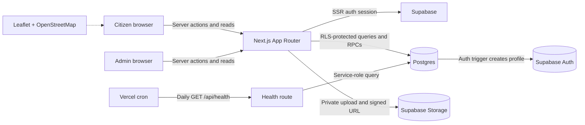

The normal application path uses the browser's authenticated Supabase session
through the Next.js server client. Row Level Security limits citizens to their
own data, while administrator-only mutations are exposed through guarded server
actions and security-definer database functions. The service-role client is
used only by the health route and never reaches the browser.

### Request lifecycle

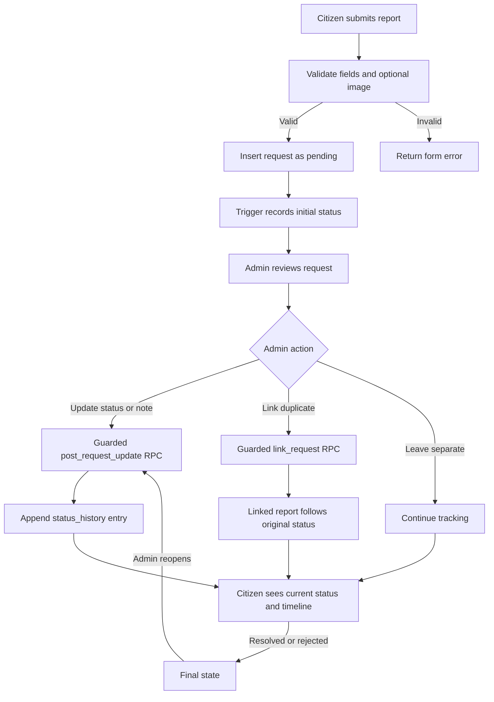

### Database schema

The Mermaid diagram provides a readable version of the same application-owned
tables and their important relationships; `auth.users` is managed by Supabase Auth.

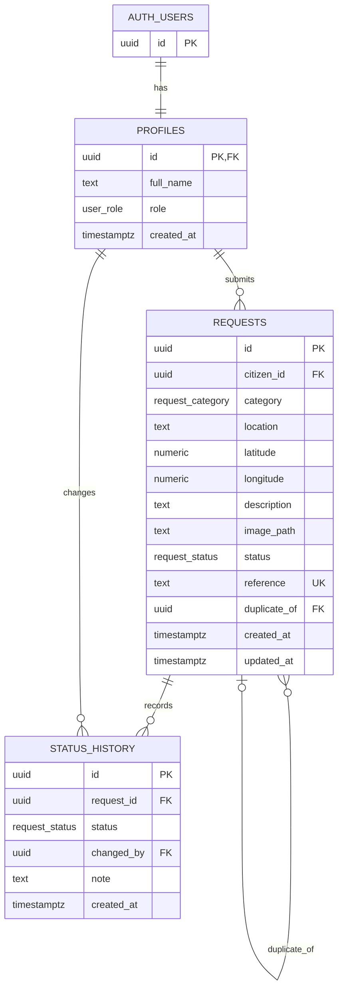

`healthcheck` is intentionally independent of the request graph and is queried
by the daily uptime endpoint. Request images are stored separately in the
private `request-images` bucket, with the first storage path segment set to the
citizen UUID and access enforced by Storage RLS policies.

Migrations in `supabase/migrations` are the single source of truth. RLS uses
the `is_admin()` security-definer helper to avoid trusting client-supplied
roles. The service role key is never sent to the browser.

The database enforces a limit of ten submissions per citizen per rolling hour.
An advisory transaction lock makes the check safe for concurrent submissions,
and the server action checks before uploading an optional image so rejected
submissions do not consume storage unnecessarily.

Rejected requests require a reason of at least ten characters. Resolved and
rejected requests are final until an administrator reopens them to in progress
with a message. Duplicate reports expose only the duplicate explanation, never
another citizen's private data; linked reports expose their own details and a
narrow public view of the original. Private images are stored under the submitting
user's UUID and are served with short-lived signed URLs.

Every request gets a unique `TAT-######` reference. Administrators link an
unlinked report to an existing primary report through atomic database functions.
The linked report keeps its own description, image and citizen visibility,
follows the original status (including rejection and reopening), and can later
be unlinked back to Pending. Database constraints reject chains, self-links and
second links.

Citizens never receive another citizen's row, image, or raw timeline through
RLS. A linked citizen can call only a narrow security-definer function for the
original's reference, category, location, coordinates, status, created date
and public timeline. Descriptions, images, reporter identity and other linked
reports are excluded.

Maps use Leaflet and OpenStreetMap tiles without an API key. The map defaults to
Murang'a town (approximately -0.72, 37.15). Place search uses Kenya-restricted
Nominatim requests only after an explicit submit, with caching and a one-request
per-second limit. Attribution is shown on every map, as required by the
OpenStreetMap and Nominatim usage policies.

Location text and the map pin stay synchronized in both directions. Dropping,
dragging, searching, or using the current location reverse-geocodes an address
when possible, while preserving text the citizen typed and offering a
confirmation before replacing it. Enter or **Find on map** geocodes only on
explicit submit; an empty result leaves the text unchanged. The expanded map
dialog has Confirm and Cancel so an exploratory pin can be discarded. Request
photos are resized in the browser to a maximum 1600 pixels on the long edge
and compressed before upload; the lightbox uses signed URLs and no paid image
transformations.

## Design decisions and limitations

- **Linked duplicates.** A duplicate report is linked to the original instead of
  being rejected. It keeps its own details and citizen visibility, follows the
  original's status (including rejection and reopening), and can be unlinked
  back to pending. Database constraints prevent chains, self-links and second
  links, and analytics count primary requests only so duplicates do not inflate
  them.
- **Privacy model.** Row Level Security keeps citizens to their own rows,
  images and timeline. A linked citizen sees only a narrow public view of the
  original — reference, category, location, coordinates, status, created date
  and public timeline — never another citizen's description, image or identity.
  The service-role key never reaches the browser, and private images are served
  with short-lived signed URLs.
- **Free-tier pausing.** Submissions are capped at ten per citizen per rolling
  hour to protect service capacity and free-tier quotas, and a daily Vercel
  cron hits `/api/health` to keep the free Supabase project active.
- **OpenStreetMap usage policy.** Maps use Leaflet and OpenStreetMap tiles
  without an API key. Place search uses Kenya-restricted Nominatim requests
  only after an explicit submit, with caching, a one-request-per-second limit,
  and attribution shown on every map.

## Local setup

1. Install Node.js 22 or newer and the Supabase CLI.
2. Clone this repository and install dependencies:

   ```bash
   npm install
   ```

3. Copy the environment template:

   ```bash
   cp .env.example .env.local
   ```

4. Set the three values in `.env.local`:

   ```text
   NEXT_PUBLIC_SUPABASE_URL=
   NEXT_PUBLIC_SUPABASE_ANON_KEY=
   SUPABASE_SERVICE_ROLE_KEY=
   ```

   Never commit `.env.local` or expose the service role key as a
   `NEXT_PUBLIC_` variable.

5. Link the Supabase CLI to the intended project, then apply migrations:

   ```bash
   supabase link --project-ref YOUR_PROJECT_REF
   supabase db push
   ```

6. Create demo data:

   ```bash
   npm run seed
   ```

7. Start the app:

   ```bash
   npm run dev
   ```

   Open [http://localhost:3000](http://localhost:3000).

## Quality checks

```bash
npm run lint
npm run typecheck
npm test
npm run build
```

GitHub Actions runs all four checks on every push and pull request.

## License

This project is licensed under the [MIT License](./LICENSE) (2026, Tevin Aduma).

## Deployment

The repository is designed for Vercel Hobby with the existing Supabase project:

1. Import the public GitHub repository into Vercel.
2. Add the three environment variables for Preview and Production.
3. Deploy the `main` branch.
4. Confirm `/api/health` returns `{"ok":true}`.

The daily cron is configured in [vercel.json](./vercel.json).

## Screenshots

### Landing and authentication

| Landing page                                                   | Sign up — light theme                                                             |
| -------------------------------------------------------------- | --------------------------------------------------------------------------------- |
| 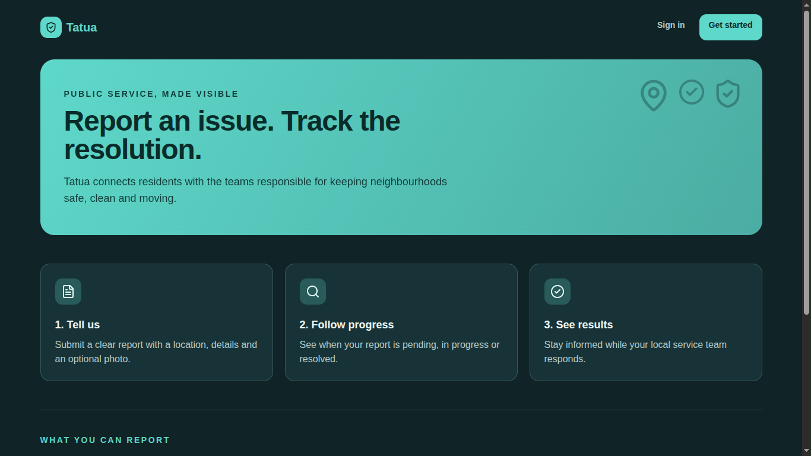 | 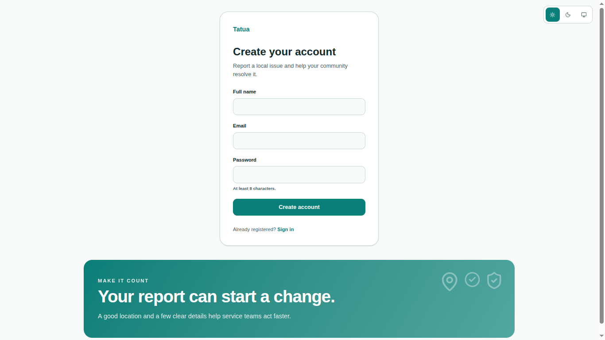 |

| Sign up — dark theme                                                            |
| ------------------------------------------------------------------------------- |
| 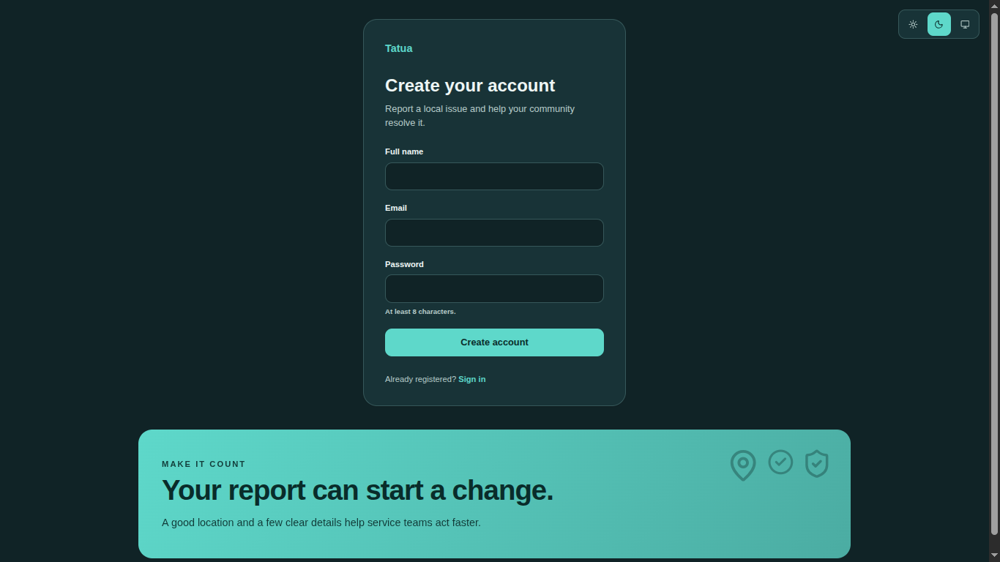 |

### Citizen experience

| Citizen landing page                                                     | Citizen requests                                                           |
| ------------------------------------------------------------------------ | -------------------------------------------------------------------------- |
| 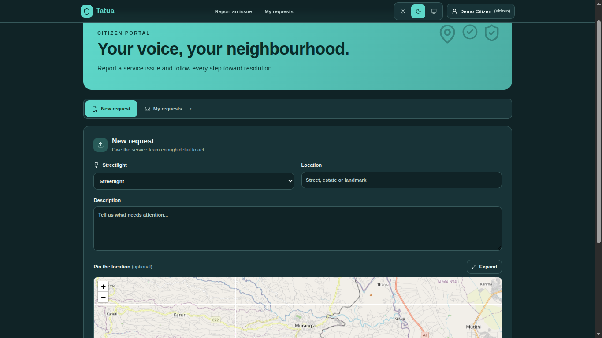 | 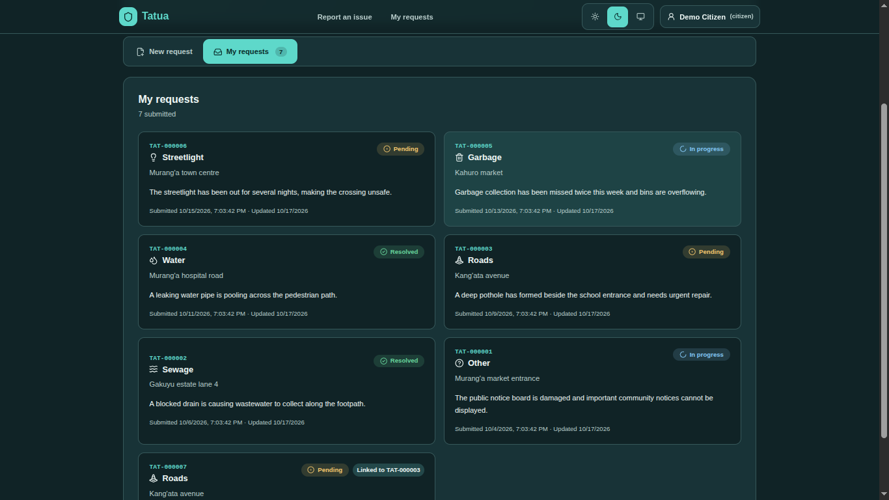 |

| Citizen request details                                                             |
| ----------------------------------------------------------------------------------- |
| 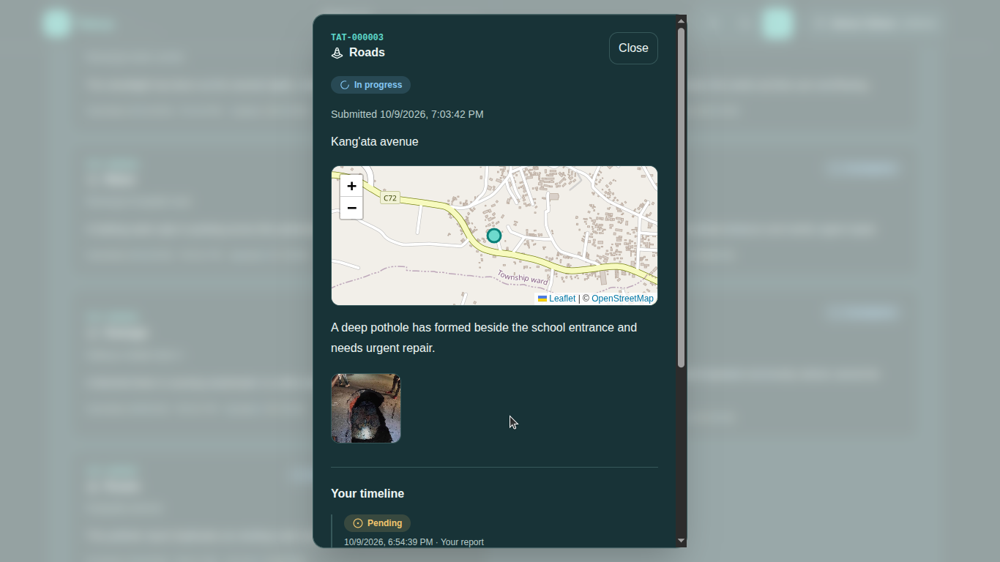 |

### Admin experience

| Admin landing page                                                   | Admin requests                                                         |
| -------------------------------------------------------------------- | ---------------------------------------------------------------------- |
| 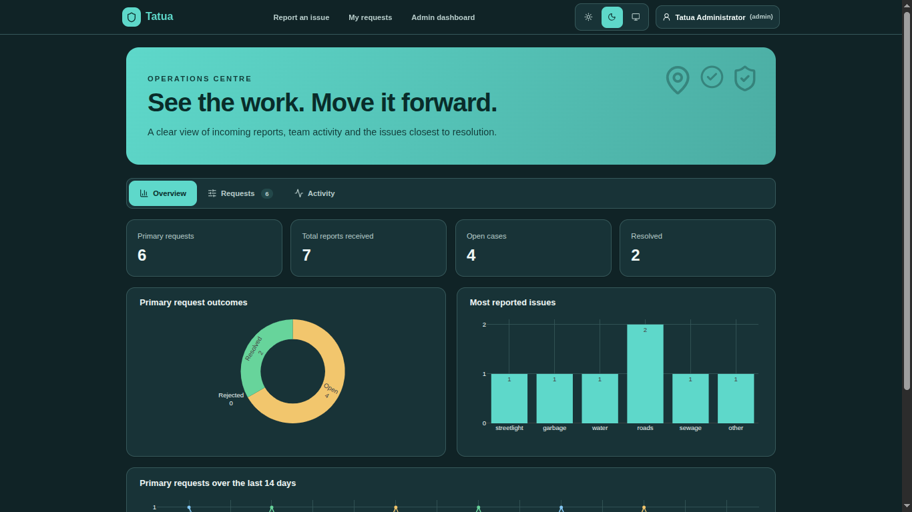 | 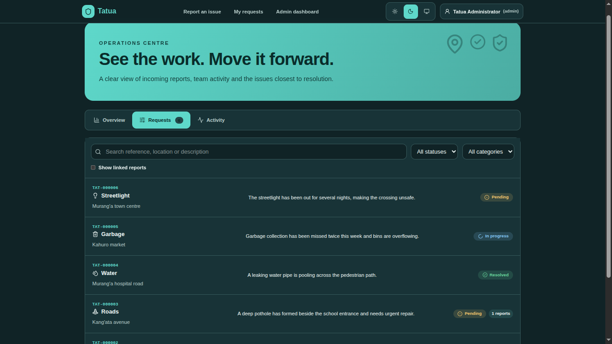 |

| Admin request details                                                           |
| ------------------------------------------------------------------------------- |
| 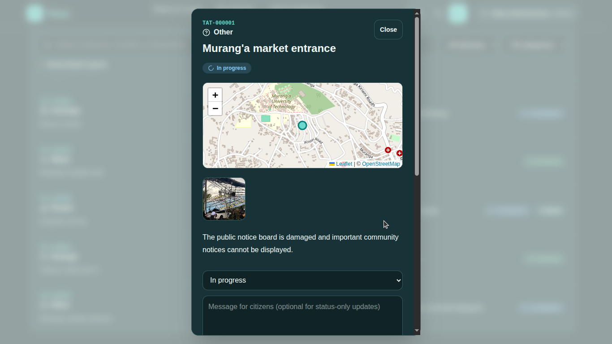 |
